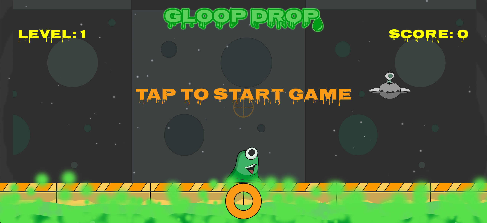
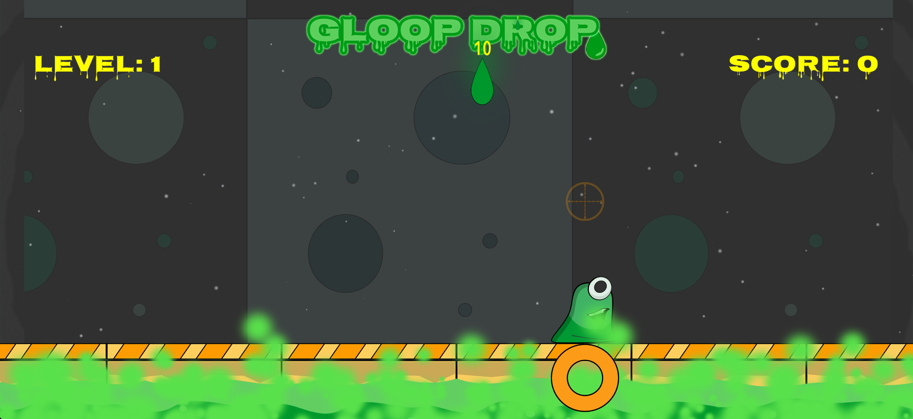

# Gloop Drop

Gloop Drop is a 2D arcade game for iPhone and iPad built with **SpriteKit** and Swift. You control Blob, a hungry green creature, and your goal is to catch every drop of gloop that falls from the sky. Miss a single drop and it's game over.

| Start screen | Gameplay |
| --- | --- |
|  |  |

## How to play

- Tap the screen to start a game.
- Drag Blob (or the orange controller ring below it) left and right to catch the falling drops.
- Each drop you catch adds points equal to the current level.
- Catch every drop in a level to advance. Each new level drops more gloop, faster.
- If a drop hits the floor, the game ends. Tap to try again.

## Features

- **Level progression:** the number of drops and their speed increase with each level, and drops are placed relative to the previous one so the player has to move further as the game gets harder.
- **Sprite animations:** Blob's walk and die animations are loaded from texture atlases and played with `SKAction.animate(with:)`.
- **Physics contacts:** collisions between the player, the drops and the floor are detected with `SKPhysicsBody` categories and `SKPhysicsContactDelegate`.
- **Endless scrolling:** the gloop river at the bottom scrolls continuously using repeating `SKAction` sequences.
- **Particle effects:** bubbling gloop and a starfield background created with SpriteKit particle emitters (`.sks` files).
- **Audio:** looping background music and ambient bubbles with `SKAudioNode`, plus sound effects for collecting and missing drops, Blob's mumbles and a passing robot.
- **Custom UI:** score, level and game messages rendered with `SKLabelNode` and a custom font (Nosifer).
- **Random events:** a robot ship flies across the screen at random intervals.

## Tech stack

| Technology | Usage |
| --- | --- |
| Swift | Game logic |
| SpriteKit | Rendering, actions, physics, particles and audio |
| UIKit | App lifecycle and the `SKView` host view controller |
| AVFoundation | Audio engine volume control |

## Project structure

| File | Description |
| --- | --- |
| `GameScene.swift` | Main scene: setup, game loop, levels, touch handling and collisions |
| `Player.swift` | Blob, the player sprite, with its animations and movement |
| `Collectible.swift` | The gloop drops and their drop, collect and miss behavior |
| `SpriteKitHelper.swift` | Shared layers, physics categories and SpriteKit extensions (animations, endless scrolling) |
| `GameViewController.swift` | Creates and presents the scene in landscape |
| `GloopFlow.sks`, `Stars.sks` | Particle emitter files |

## Requirements

- Xcode 27 or later
- iOS 18.6 or later
- iPhone or iPad (landscape only)

## Running the game

1. Clone the repository.
2. Open `gloopdrop.xcodeproj` in Xcode.
3. Select an iPhone or iPad simulator (or a connected device) and press **Run**.

## Credits

Based on the Gloop Drop project from *Apple Game Frameworks and Technology* by Tammy Coron (Pragmatic Bookshelf).
